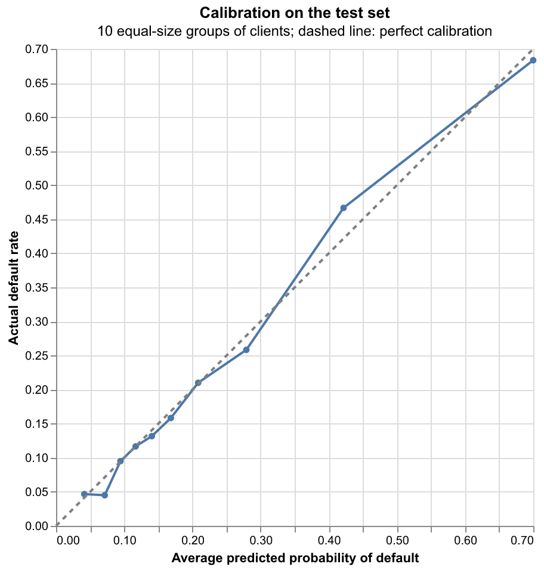
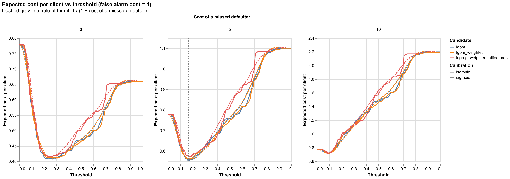
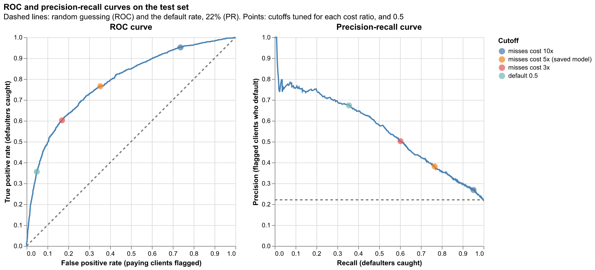
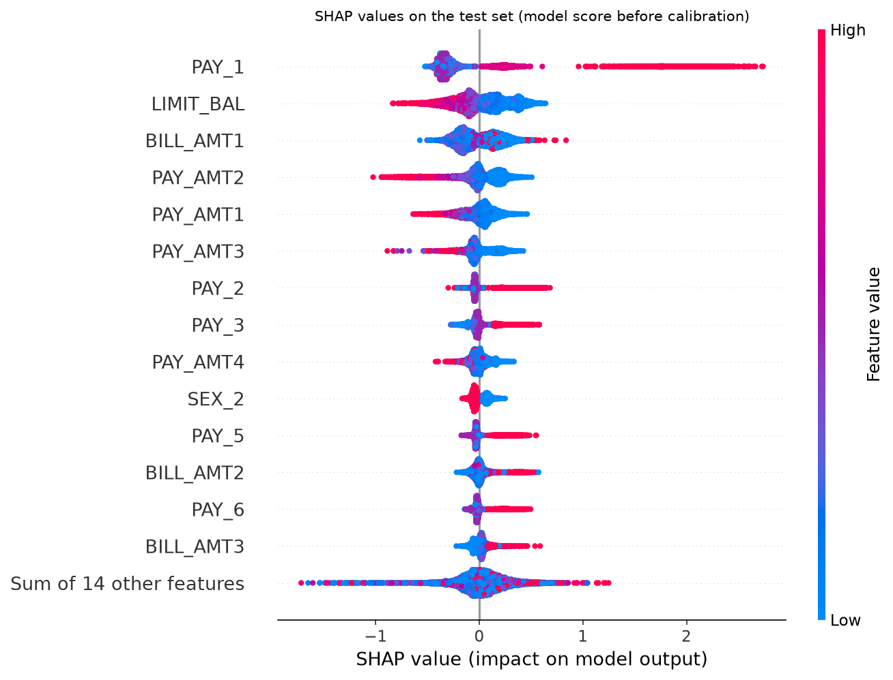
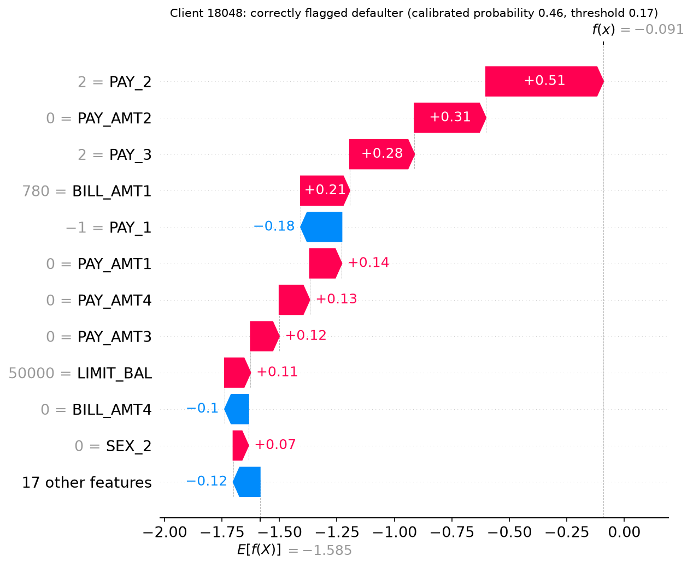
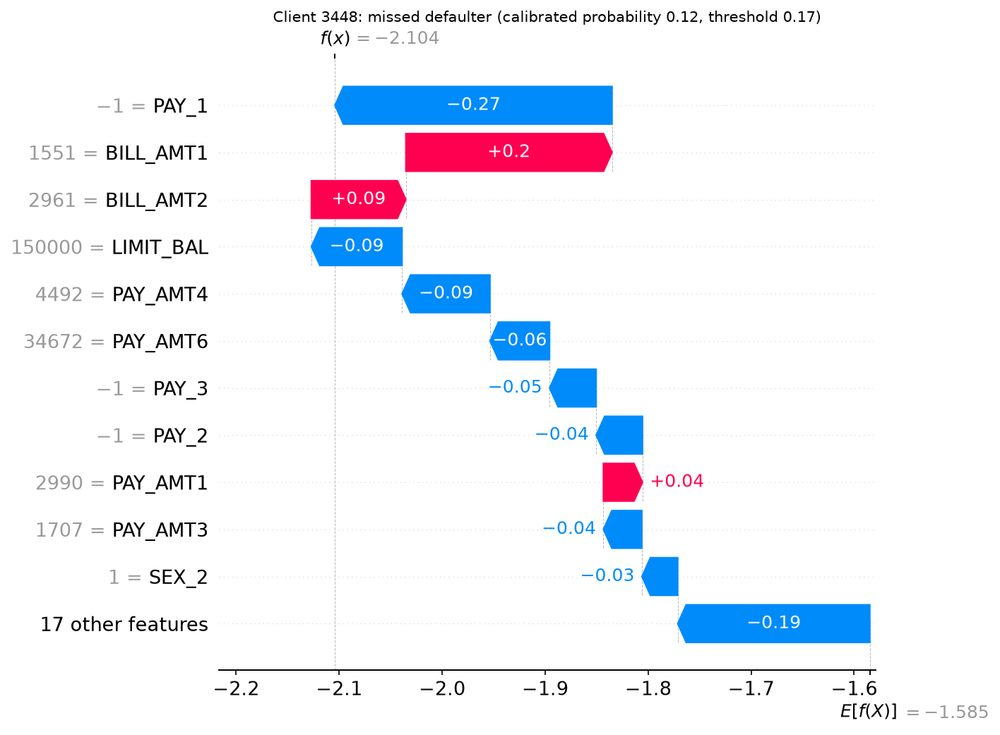

# Results: who to flag, and why

This page walks through what the project found, step by step, for a reader without a
machine learning background. Every number comes from a file in `reports/`, produced by
`make all` (see [How to reproduce](#how-to-reproduce)).

## 1. The question

A bank issues credit cards. Each month, some card holders miss their payment ("default").
If the bank could tell in advance which clients are likely to default, it could act
early: review the account, lower the credit limit, or contact the client.

The data covers 30,000 card holders in Taiwan in 2005: their credit limit, some
demographics, and six months of history (whether each bill was paid on time, the bill
amount, and the amount paid). About **22%** of them defaulted the following month.

The project builds a model that answers, for each client: **should the bank flag this
client as likely to default?**

## 2. Why "accuracy" is the wrong score

The simplest way to score a yes/no prediction is accuracy: the share of clients it gets
right. Here that is misleading. Because 78% of clients pay, a rule that flags nobody is
78% accurate, and it catches no defaulters at all.

A better score starts from the two ways a flag can be wrong:

- **Missed defaulter:** the client is not flagged and then defaults. The bank loses much
  of what it lent.
- **False alarm:** the client is flagged but would have paid. The bank inconveniences or
  loses a good client.

These are not equally bad. This project assumes a missed defaulter costs **5 times** as
much as a false alarm, the ratio used in a widely cited credit scoring dataset (Statlog
German Credit). Each result below is reported as an **average cost per client**, where a
false alarm costs 1 and a missed defaulter costs 5. Lower is better.

Two simple rules set the bar any model has to beat (test set, 6,000 clients):

| Rule | Defaulters caught | False alarms | Cost per client |
|---|---|---|---|
| Flag nobody | 0 of 1,327 | 0 | 1.106 |
| Flag everyone | 1,327 of 1,327 | 4,673 | 0.779 |

Flagging everyone is cheaper than flagging nobody, because misses are so expensive. A
useful model has to do better than both.

## 3. Step 1: rank clients by risk

The model does not output "yes" or "no". It gives each client a **probability of
default**, a number between 0 and 1. Turning that into a decision is a separate step
(section 5).

The first job is to **rank** clients well: defaulters should get higher numbers than
clients who pay. The score used for ranking is ROC-AUC: the chance that the model gives a
randomly chosen defaulter a higher number than a randomly chosen client who paid. 0.5 is
a coin flip; 1.0 is perfect.

Four model types were compared, each checked 5 times on different slices of the training
data (cross-validation):

| Model | ROC-AUC |
|---|---|
| Baseline (gives everyone the same number) | 0.500 |
| Logistic regression | 0.722 |
| Random forest | 0.759 |
| XGBoost | 0.760 |
| **LightGBM** | **0.776** |

LightGBM ranked best. Published results on this dataset are roughly 0.77 to 0.80, so it
is close to what these columns support.

Two other ideas were tested on top of LightGBM, and neither improved the ranking:

| Change | ROC-AUC |
|---|---|
| LightGBM as is | 0.776 |
| Giving defaulters more weight during training | 0.775 |
| Training on fewer paying clients, to even out the 22/78 split | 0.773 |
| Adding synthetic defaulters, to even out the split | 0.766 |
| Giving defaulters more weight, plus 4 groups of engineered columns (months late, payment-to-bill ratio, credit used, trends) | 0.777 |

The first three changes are common fixes for the fact that defaulters are a minority.
They make the model give everyone higher numbers, which flags more clients at a fixed
cutoff, but they barely change who is ranked above whom. The engineered columns added
0.002 over the weighted model, about the size of the variation between data slices. The project handles the minority problem
in the cutoff instead (section 5). Full table: `reports/tables/experiments.csv`.

## 4. Step 2: make the probabilities honest

For the cutoff in section 5 to work, a probability of 0.30 has to mean that about 30% of
such clients really default. Raw model numbers often do not behave that way. A
**calibration** step fixes this: on data the model did not train on, it compares the
model's numbers with what actually happened, and learns a correction. The correction
keeps the ranking the same; it only changes the numbers.



How to read it: test clients are sorted by their predicted probability and cut into 10
equal groups. Each dot is one group: its average predicted probability (across) against
the share that actually defaulted (up). The dashed line is where the two are equal.

The dots stay close to the line. The largest gap is a group predicted at about 42% that
defaulted at 47%. So on clients the model has never seen, its probabilities can be read
as real chances of default.

## 5. Step 3: let the costs set the cutoff

To make a decision, the bank flags every client whose probability is above a **cutoff**
(threshold). The usual default is 0.5: flag clients who are more likely than not to
default.

With honest probabilities and known costs, the cutoff can be worked out instead. For a
client with probability p:

- flagging them costs 1 if they would have paid, which happens with chance (1 - p);
- not flagging them costs 5 if they default, which happens with chance p.

Flagging is the cheaper choice when 5p is greater than (1 - p), which is when p is above
**1/6, about 0.17**. When a miss costs 5 times a false alarm, a 1-in-6 chance of default
is enough to flag. The 0.5 default only makes sense if both mistakes cost the same.

The project also searched for the cutoff directly, by trying 100 cutoffs and keeping the
cheapest on the training data:



Each panel is a different cost for a missed defaulter (3, 5 and 10). Each line is one
candidate model. The dip in each line is the cheapest cutoff; the dotted vertical line is
the 1 / (1 + cost) formula. The search lands where the formula says it should:

| Cost of a missed defaulter (false alarm = 1) | Formula | Cutoff found |
|---|---|---|
| 3 | 0.25 | 0.26 |
| 5 | 0.17 | 0.17 |
| 10 | 0.09 | 0.09 |

The higher the cost of a miss, the lower the cutoff, and the more clients get flagged.
The final model uses LightGBM, calibrated, with a cutoff of **0.17** (5:1 costs). Full
table: `reports/tables/decision.csv`.

## 6. Results on clients the model never saw

All of the choices above were made on training data. 6,000 clients (20%) were set aside
at the start and used once, at the end, to check the final model.

| | Model, cutoff 0.17 | Same model, cutoff 0.5 | Flag everyone |
|---|---|---|---|
| Clients flagged | 2,666 | 701 | 6,000 |
| Defaulters caught (of 1,327) | **1,016 (77%)** | 472 (36%) | 1,327 (100%) |
| Defaulters missed | 311 | 855 | 0 |
| False alarms (of 4,673 who paid) | 1,650 (35%) | 229 (5%) | 4,673 (100%) |
| **Cost per client** | **0.534** | 0.751 | 0.779 |

- **The cost-based cutoff is the main gain.** The same model, with the same probabilities,
  costs 0.751 per client at 0.5 and 0.534 at 0.17: 29% less.
- **The training estimate held up.** Training data predicted a cost of 0.555 and a
  ROC-AUC of 0.776; the unseen clients gave 0.534 and 0.788.
- **The price is false alarms.** To catch 77% of defaulters, the model flags 44% of all
  clients, and about 1 in 3 clients who would have paid gets flagged. That is what a 5:1
  cost ratio implies. A flag suits a softer action (a review, a lower limit) better than
  an outright refusal.

Full table: `reports/tables/test_metrics.csv`.

### The trade-off at every cutoff

The table shows two cutoffs. The curves below show all of them at once, on the same
unseen clients, with the cutoffs for each cost ratio marked.

Everything in this section comes from one scoring of the test set. The final model was
fitted on training data only, then gave each of the 6,000 test clients one probability
of default. Nothing was refitted after that. A cutoff only sorts those fixed
probabilities into "flag" and "don't flag", so trying a different cutoff, or drawing a
curve through every cutoff, is a different way of counting the same predictions, not a
new test.

What would break the test is choosing something because of what it shows. Every cutoff
below was set on training data in section 5 before the test set was used, and the
final model stays at 0.17 whatever these results say. The 3x and 10x rows show what
those other cost ratios would give; they are not candidates to switch to. Picking the
cutoff that looks best here would tune the model on the test set, and its test result
would then overstate how it does on new clients.



How to read it: each curve traces what happens as the cutoff slides from high (bottom
left of the ROC curve, top left of the precision-recall curve) to low.

- **ROC curve (left):** share of defaulters caught (up) against share of paying clients
  flagged (across). The dashed diagonal is random guessing. The area under this curve is
  the ROC-AUC of 0.788.
- **Precision-recall curve (right):** share of flagged clients who really default (up)
  against share of defaulters caught (across). The dashed line is 22%, the default rate,
  which is what flagging everyone would give. The area under this curve is the PR-AUC of
  0.554. With only 22% of clients defaulting, this panel shows the cost of false alarms
  more plainly than ROC does.

The cost search in section 5 does not use these curves, but for a given cost ratio it
picks one point on them. The markers show where each ratio lands:

| Cutoff | Defaulters caught | Flagged clients who default | Paying clients flagged |
|---|---|---|---|
| 0.5 (default) | 36% | 67% | 5% |
| 0.26 (misses cost 3x) | 60% | 50% | 17% |
| **0.17 (misses cost 5x, final model)** | **77%** | **38%** | **35%** |
| 0.09 (misses cost 10x) | 95% | 27% | 74% |

- **The cost ratio matters more than the choice of model.** In section 5 the candidate
  models differed by about 0.02 in cost per client. Moving from 3x to 10x changes the
  share of defaulters caught from 60% to 95%, and the share of paying clients flagged
  from 17% to 74%. The 5:1 ratio is borrowed from another dataset (section 2), so it is
  the assumption to check first before using this model.
- **There is no natural break in the curve.** Precision falls steadily as more
  defaulters are caught, so each extra defaulter costs a little more in false alarms
  than the one before. Nothing in the data points to a "best" cutoff on its own; the
  costs have to decide it.

## 7. What drives the predictions

SHAP is a method that splits each client's score into contributions from each column:
how much each piece of information pushed that client's risk up or down.



How to read it: one row per column, the most influential at the top. Each dot is one
client. Dots to the right mean that column pushed the client's risk up; to the left, down.
Color shows the column's value for that client (red high, blue low).

- **Last month's repayment status (`PAY_1`) matters most**, more than twice as much as
  any other column. Red dots far to the right: clients who were late last month are much
  riskier.
- **Credit limit (`LIMIT_BAL`) is second.** Red dots on the left: a higher limit means
  lower risk, possibly because the bank had already given more credit to clients it trusted.
- **Recent payment amounts (`PAY_AMT1` to `PAY_AMT3`)**: larger payments mean lower risk.

Two individual clients show how this adds up. Each chart starts from the average score at
the bottom; each bar is one column pushing the score up (red) or down (blue).

**A defaulter the model caught** (probability 0.46, above the 0.17 cutoff):



This client paid in full last month, which pulled risk down. But they were 2 months late
in each of the two months before, and paid nothing in four of the recent months. Those
signals outweighed the good month.

**A defaulter the model missed** (probability 0.12, below the cutoff):



This client paid in full in each of the last three months, had a 150,000 credit limit, and made a
large payment six months earlier. Only the recent bill amounts pushed risk up, and not by
much. Nothing in the data warned of this default. Catching clients like this would need a
much lower cutoff, which would flag many more clients who pay.

The two clients were picked by a fixed rule (the client nearest the middle of each group),
not chosen for the story. Full ranking: `reports/tables/shap_importance.csv`.

## 8. Limitations and fairness

**Limitations**

- **One country, one year.** The data is from Taiwan in 2005. Patterns may not carry over
  to other places, other years, or other kinds of credit.
- **The costs are an assumption.** The 5:1 ratio is borrowed from another dataset, not
  measured from a bank's losses. Real costs depend on balances, recovery rates and the
  value of each client, which this data does not include. Section 5 shows how the cutoff
  moves at 3:1 and 10:1.
- **One test set gives one number.** The test cost of 0.534 has a margin of roughly ±0.03.
  The gap to the training estimate (0.555) is within it.
- **SHAP explains the model, not the world.** It shows what the model relies on, not what
  causes default. A column can matter because it stands in for something not recorded.

**Fairness**

The model's inputs include sex, marital status, age and education. Using these in credit
decisions is restricted by law in many places, and raises ethical concerns where it is
not.

The model does use them, though less than the payment history. In the SHAP ranking of 28
columns, being female (`SEX_2`) ranks 10th and lowers predicted risk slightly. Marital
status ranks 20th and age 21st.

What was **not** done:

- The model was not retrained without these columns to see what that would cost.
- Error rates (missed defaulters, false alarms) were not compared across groups, so it is
  not known whether one group is flagged wrongly more often than another.

Removing the columns would not settle the question by itself: other columns, such as
credit limit, may carry some of the same information. Both checks above would be needed
before a model like this were used for real decisions.

## How to reproduce

```bash
make setup                # create the conda environment
conda activate credit-risk
make all                  # runs every stage
```

| Section | Produced by | Files |
|---|---|---|
| 3 | `make experiments` | `reports/tables/experiments.csv` |
| 5 | `make decide`, `make train` | `reports/tables/decision.csv`, `reports/figures/cost_vs_threshold.png` |
| 4, 6 | `make evaluate` | `reports/tables/test_metrics.csv`, `reports/figures/calibration_test.png`, `reports/figures/roc_pr_test.png` |
| 7 | `make explain` | `reports/tables/shap_importance.csv`, `reports/figures/shap_*.png` |

How each step works, and why each choice was made, is in `docs/learning-log.md`.
